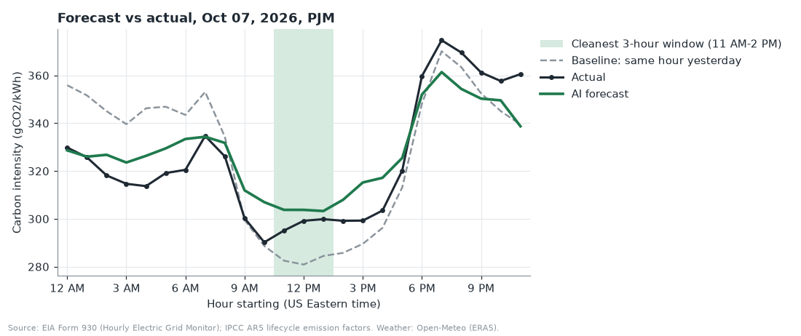
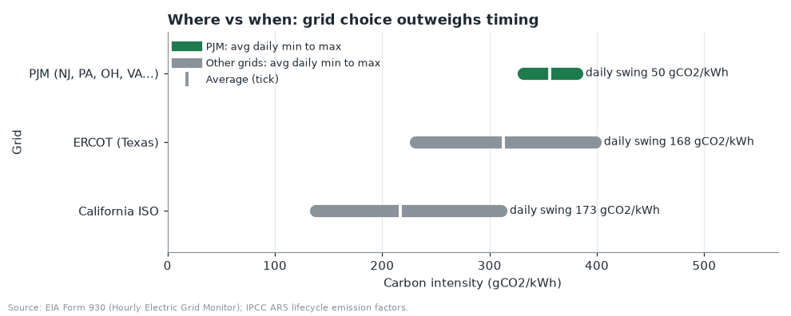
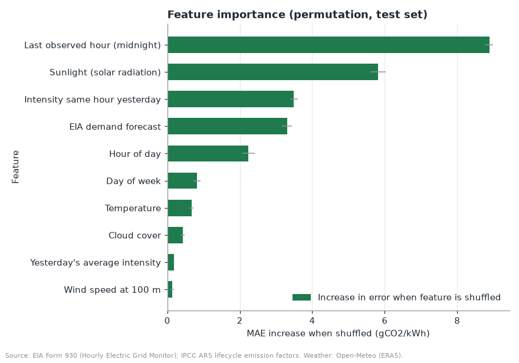

# CleanHour

CleanHour forecasts hourly grid carbon intensity (gCO2/kWh) for PJM, the grid that
serves Princeton, NJ. It recommends the cleanest 3-hour window to run appliances and
shows that, for New Jersey, which grid you are on matters more than when you plug in.



## What it does

- **Day-ahead forecast.** A machine learning model predicts all 24 hours of a day before
  the day starts. The app shows the forecast, the actual values (on past days), a
  "same hour yesterday" baseline, and the cleanest 3-hour window shaded.
- **Tomorrow (live).** Forecasts tomorrow using the latest EIA data (API v2) and the
  Open-Meteo weather forecast.
- **Appliance scheduler.** Pick appliances (EV 7 kWh, dryer 3 kWh, dishwasher 1.5 kWh,
  all editable). Each one is scheduled into its cleanest window, with kg CO2 saved versus
  the dirtiest and typical times, plus a scale-up to 10,000 Princeton households per year.
- **Where vs when.** Compares the average daily swing in PJM with California (CISO) and
  Texas (ERCOT).

## Why it matters

PJM is the largest US grid operator, serving about 65 million people in 13 states and DC.
In 2025-2026 its generation was about 42% natural gas, 31% nuclear, and 17% coal,
averaging about 356 gCO2/kWh. Shifting flexible loads to cleaner hours is free, but in
PJM the gain is modest: on an average day the cleanest hour is only about 24 gCO2/kWh
below the day average, while California's grid averages 139 gCO2/kWh lower than PJM.



## How to run

```bash
python3 -m venv .venv
.venv/bin/pip install -r requirements.txt
.venv/bin/streamlit run app.py
```

The cleaned data (`data/*.csv`) and trained model (`models/`) are committed, so the app
works offline. To rebuild from scratch (downloads ~170 MB of EIA CSVs):

```bash
.venv/bin/python data.py
.venv/bin/python model.py
```

Optional live mode: put a free EIA API key in `.env` as `EIA_API_KEY=...`
(get one at https://www.eia.gov/opendata/). Without it, the app still runs and shows
the most recent test day instead of tomorrow.

## Code layout

| File | Role |
|---|---|
| `data.py` | Downloads and cleans EIA-930 data and Open-Meteo weather, computes intensity, live API fetches. Never draws. |
| `features.py` | Day-ahead feature frame (only information available at midnight before the day). |
| `model.py` | Training, baselines, metrics, permutation importance, live tomorrow forecast. |
| `charts.py` | Matplotlib figures from DataFrames. Never fetches. |
| `app.py` | Streamlit app. |

## Model and metrics

- **Target:** hourly PJM intensity for each of the 24 hours of the next day.
- **Features:** hour, day of week, month, intensity 24h and 168h earlier, yesterday's
  mean, last observed hour before midnight, temperature, solar radiation, 100 m wind
  speed, cloud cover (average of Princeton NJ, Columbus OH, Richmond VA), and EIA's
  day-ahead demand forecast.
- **Model:** scikit-learn `HistGradientBoostingRegressor` (absolute-error loss).
- **Split:** by time. Train on 2025-01-08 to 2026-08-09, test on 2026-08-10 to 2026-10-09
  (61 days, 1,464 hours). No random split.

| Method | MAE (gCO2/kWh) | Cleanest window exact hit | Window overlap | Extra vs true best (gCO2/kWh) |
|---|---|---|---|---|
| AI model | **8.7** | **31%** | 70% | **3.5** |
| Same hour yesterday | 14.3 | 26% | 72% | 3.6 |
| Hour-of-day average | 24.7 | 11% | 80% | 5.1 |

The model's error is **39% lower** than "same hour yesterday" and **65% lower** than the
hour-of-day average. Honestly, picking the single cleanest window is harder: the model
hits it exactly more often, but its overlap rate and the extra intensity paid are close
to persistence. The hour-of-day average always picks the same midday block, which
overlaps often but pays the most extra. PJM's small within-day swing is why timing
matters less here than grid choice.



## Limitations

- **Production-based, not consumption-based.** Imports from neighboring grids are not counted.
- **Average, not marginal, intensity.** The plant that responds to extra load (usually gas)
  can be dirtier than the average, so real savings from load shifting may differ.
- **Actual weather stands in for forecasts in the backtest,** so test metrics are somewhat
  optimistic. Live mode uses a real forecast, but EIA data can lag about a day, so the
  "yesterday" features fall back to the most recent available day.
- **Emission factors are lifecycle medians.** "Other" and unknown fuels are assumed
  gas-like (490 gCO2/kWh); storage is excluded. Geothermal (CISO only) uses 38.
- Yearly scale-up assumes the stated runs per week and the test-period average saving.

See `NOTES.md` for every judgment call made during the build.

## Data credits

- **U.S. Energy Information Administration, Form EIA-930** (Hourly Electric Grid Monitor):
  six-month balance files and API v2 hourly fuel mix and demand forecast.
- **Open-Meteo:** historical weather from the ERA5 reanalysis (Copernicus/ECMWF) and the
  forecast API.
- **IPCC AR5 (2014), Annex III:** lifecycle emission factors (gCO2eq/kWh): coal 820,
  gas 490, oil 720, nuclear 12, hydro 24, solar 48, wind 11, geothermal 38.
